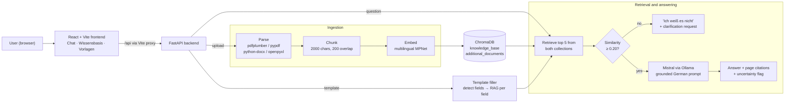

# Nova – Municipal AI Assistant for the Energy Transition

Built by a team of five at the **Black Forest Hackathon** (8–10 May 2026) for the challenge
*"Municipal AI Assistant: Taming Documents, Accelerating the Energy Transition"*.

Nova is a web application that helps municipal administrations work with energy-transition
documents such as laws, concession contracts and heat plans. It answers questions with
page-level citations, says **"I don't know"** when the documents don't support an answer,
and semi-automatically fills municipal templates (Excel, Word, PDF forms) from the knowledge base.

---

## My Contributions

I built the retrieval and answer-generation core of the RAG pipeline (`backend/rag_chain.py`):

- **Retrieval layer** - searches both ChromaDB collections (knowledge base and additional documents),
  merges and ranks the results by cosine distance, and keeps the top 5 passages.
- **"Ich weiß es nicht" gate** - converts distances to similarity scores and applies a relevance threshold.
  If no passage clears it, the assistant says it doesn't know and asks for more context, without calling the LLM.
- **Grounded generation** - the German system prompt and answer template that require a source
  (document, page) after every claim, direct quotes in quotation marks, and an explicit "ICH WEISS ES NICHT"
  when the passages don't contain the answer. Mistral is called through Ollama with low temperature
  and capped context and output lengths.
- **Citations and uncertainty flag** - returns structured citations (file, page, excerpt, relevance score)
  to the UI and detects when the model itself flags uncertainty.

The same pipeline also powers template filling, where each detected field is answered as its own RAG query.

---

## The Challenge

Municipalities have to implement the fast-changing requirements of the energy transition
with limited staff and expertise, while the legal framework is spread across many sources.
General-purpose AI tools don't give answers that a public authority can cite and rely on.

The task was to build a standalone web app that:

- answers questions from a curated knowledge base (laws, plans, contracts) **with citations**,
- **transparently flags uncertainty** through a mandatory "I don't know" mechanism,
- picks up and reuses content from **additional documents** uploaded by the user,
- **fills municipal templates** (Excel, Word, PDF forms) automatically or semi-automatically,
- and is designed so that it can later run fully **data-protection compliant**, on European hosting and models.

The source documents and the target users are German, so the interface and all answers are in German.

---

## Features

- **Cited answers** - Every statement in an answer references its source document and page;
  the UI shows the retrieved passages as citation cards with their relevance scores.
- **"Ich weiß es nicht" mechanism** - If nothing relevant is retrieved, or the model can't answer
  from the passages, the assistant says so and asks for more documents or a more specific question
  instead of guessing.
- **Two knowledge sources** - A curated *knowledge base* plus *additional documents* that users attach
  directly in the chat or upload on the dashboard. Retrieval searches both and ranks the results together.
- **Knowledge base management** - Upload, delete and re-index documents (PDF, DOCX, XLSX) from the UI.
  Files placed in the data folders are indexed automatically when the backend starts.
- **Template filling with a human in the loop** - Upload a template; Nova detects the fields,
  fills each one via RAG, and marks it as *filled*, *uncertain* or *needs input*. The user reviews
  and completes the gaps, then exports the finished file with its sources attached.
- **Self-hosted AI** - No third-party AI APIs: the LLM is served through Ollama on your own
  hardware and embeddings are computed inside the backend.

---

## Architecture



---

## Design Choices

**Grounding over fluency** - The system prompt requires a source after every important statement
(`(document, page X)`), direct quotes in quotation marks, and answers based only on the retrieved
passages. Temperature is kept at 0.1 for consistent, factual output.

**Two layers of uncertainty** - Uncertainty is caught before *and* after generation:
1. *Retrieval gate:* passages are converted to a cosine similarity score; if none clears the threshold,
   the LLM isn't called at all and the user gets "ICH WEISS ES NICHT" plus a request for more context.
2. *Model self-report:* the prompt tells the model to answer "ICH WEISS ES NICHT" when the passages
   don't contain the answer; the backend detects this and the UI highlights the answer as uncertain.

**Multilingual embeddings for German legal text** - Documents are embedded with
`sentence-transformers/paraphrase-multilingual-mpnet-base-v2`, which handles German well and runs
in-process, so document text never leaves the backend for embedding.

**Context-preserving chunking** - Legal and planning documents have long, connected passages, so chunks are
large (2,000 characters) with a 200-character overlap. Each chunk stores its file, page (or Excel sheet),
chunk index and character offsets, which is what makes page-level citations possible.

**Human-in-the-loop template filling** - Each detected field becomes its own RAG query. The top citation's
relevance score is used as a confidence value, and every field gets a status. Users fill or correct what
the model couldn't, and the export keeps the sources: Excel cells get a comment with the source, and Word
placeholders get an inline `[Quelle: …]`.

**Built to swap models and hosting** - The LLM endpoint and model are set through environment variables,
so the same app can run against a local Ollama, an on-premise GPU server or a European-hosted model.

---

## Tech Stack

| Layer | Technologies |
|---|---|
| Backend | Python 3.11+, FastAPI, Uvicorn |
| LLM | Mistral served through Ollama (`langchain-ollama`) |
| Retrieval | ChromaDB (persistent, cosine), sentence-transformers, LangChain text splitters |
| Document parsing | pdfplumber, pypdf, python-docx, openpyxl, pdfrw (PDF forms) |
| Frontend | React 19, TypeScript, Vite, Axios, react-markdown, Lucide icons |

---

## Getting Started

### Prerequisites

- Python 3.11+
- Node.js 20+
- An Ollama endpoint serving a chat model (local or on a server)

### 1. Set up the LLM endpoint

By default the backend expects an Ollama endpoint at `http://localhost:8080` serving
`mistral-large:123b`. That is the setup used at the hackathon, where the model ran on a GPU server.

To run everything on your own machine with a smaller model instead:

```bash
ollama pull mistral
ollama serve        # listens on http://localhost:11434
```

Then create `municipal-ai-assistant/backend/.env`:

```env
OLLAMA_BASE_URL=http://localhost:11434
CHAT_MODEL=mistral
```

### 2. Start the backend

```bash
cd municipal-ai-assistant/backend

python -m venv .venv
.venv\Scripts\activate          # Windows
# source .venv/bin/activate     # macOS / Linux

pip install -r requirements.txt
uvicorn main:app --reload --host 0.0.0.0 --port 8000
```

- API: http://localhost:8000
- Interactive API docs: http://localhost:8000/docs

On first start, the embedding model (about 1 GB) is downloaded from Hugging Face.
After that, embeddings are computed locally.

### 3. Start the frontend

```bash
cd municipal-ai-assistant/frontend
npm install
npm run dev
```

Open http://localhost:5173. The dev server forwards `/api` calls to the backend on port 8000.

### 4. Add your own documents

The hackathon documents were provided privately and are **not** part of this repository,
so the knowledge base starts empty. Add your own documents in either of these ways:

- **In the app** - open **Wissensbasis**, choose *Knowledge base* or *Additional documents*, and upload
  PDF, DOCX or XLSX files. You can also attach documents directly in the chat.
- **On disk** - put files into `municipal-ai-assistant/backend/data/knowledge_base/` or
  `.../data/additional_documents/` and restart the backend. They are indexed automatically on startup.

### 5. Fill a template

Open **Vorlagen ausfüllen** and upload a template. Nova recognises:

- **Word / Excel** - placeholders written as `{{Feldname}}`, `[FELDNAME]` or `___`
- **PDF** - fillable form fields (AcroForm)

Review the suggested values, fill in anything marked as uncertain or missing, and export the completed file.

---

## Configuration

| Variable | Default | Purpose |
|---|---|---|
| `OLLAMA_BASE_URL` | `http://localhost:8080` | Ollama endpoint serving the chat model |
| `CHAT_MODEL` | `mistral-large:123b` | Model name on that endpoint |

Set these in `municipal-ai-assistant/backend/.env`. Retrieval settings (chunk size, overlap, top-k,
relevance threshold, temperature, max output tokens) are in `backend/config.py`.
The embedding model is set in `backend/ingestion.py`.

---

## API Overview

| Method | Endpoint | Description |
|---|---|---|
| `GET` | `/health` | Status and configured models |
| `POST` | `/api/chat` | Ask a question; returns answer, citations and uncertainty flag |
| `GET` | `/api/documents` | List indexed documents with chunk counts |
| `POST` | `/api/documents/upload` | Upload and index a document (`knowledge_base` or `additional_documents`) |
| `DELETE` | `/api/documents/{doc_type}/{filename}` | Remove a document and its chunks |
| `POST` | `/api/documents/reindex` | Re-index all documents |
| `POST` | `/api/templates/analyze` | Upload a template, detect fields and pre-fill them via RAG |
| `POST` | `/api/templates/update-fields` | Submit user values for open fields |
| `POST` | `/api/templates/export/{session_id}` | Download the filled template |
| `GET` | `/api/templates/session/{session_id}` | Get the current state of a template session |

---

## Project Structure

```text
BlackForestHackathon/
├── municipal-ai-assistant/
│   ├── backend/
│   │   ├── main.py              # FastAPI app and REST endpoints
│   │   ├── config.py            # Paths, model endpoint, retrieval settings
│   │   ├── ingestion.py         # Parsing, chunking, embedding, ChromaDB storage
│   │   ├── rag_chain.py         # Retrieval, prompting, citations, "I don't know" logic
│   │   ├── template_filler.py   # Field detection and filling for XLSX / DOCX / PDF
│   │   ├── requirements.txt
│   │   └── data/                # Created at runtime: documents, vector store, filled templates (not versioned)
│   ├── frontend/
│   │   ├── src/
│   │   │   ├── pages/           # Chat, Dashboard (knowledge base), Templates
│   │   │   ├── components/      # CitationCard
│   │   │   ├── api.ts           # Typed API client
│   │   │   └── App.tsx          # Layout and navigation
│   │   ├── package.json
│   │   └── vite.config.ts       # Dev server with /api proxy to the backend
│   └── setup_data.ps1           # Hackathon only: copies the private challenge documents into data/
└── README.md
```

---

## Troubleshooting

- **Chat answers fail or time out** - check that the Ollama endpoint in `OLLAMA_BASE_URL` is reachable
  and serves the model in `CHAT_MODEL` (`curl <OLLAMA_BASE_URL>/api/tags`).
- **Every answer is "Ich weiß es nicht"** - the knowledge base is probably empty. Upload documents first,
  or check the backend log for the startup indexing summary.
- **First backend start is slow** - the embedding model is being downloaded; later starts are fast.
- **Frontend can't reach the API** - make sure the backend is running on port 8000.
